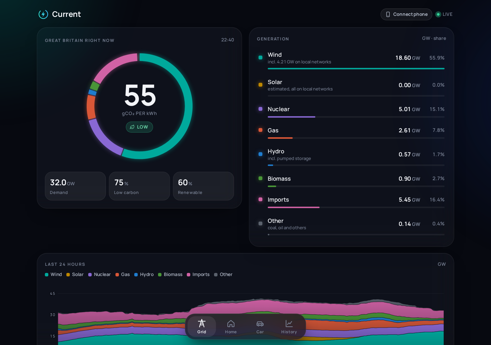
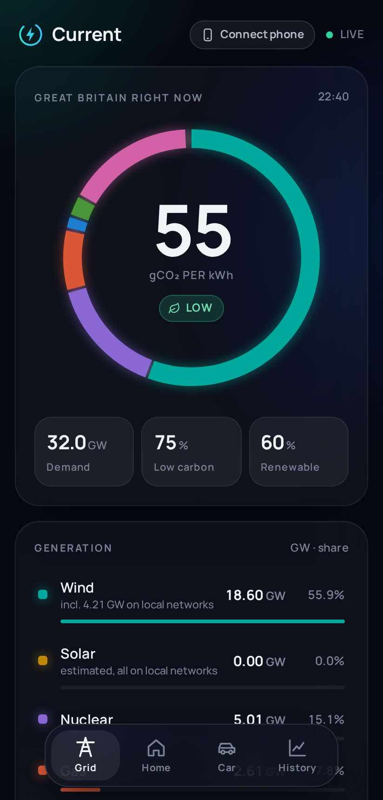
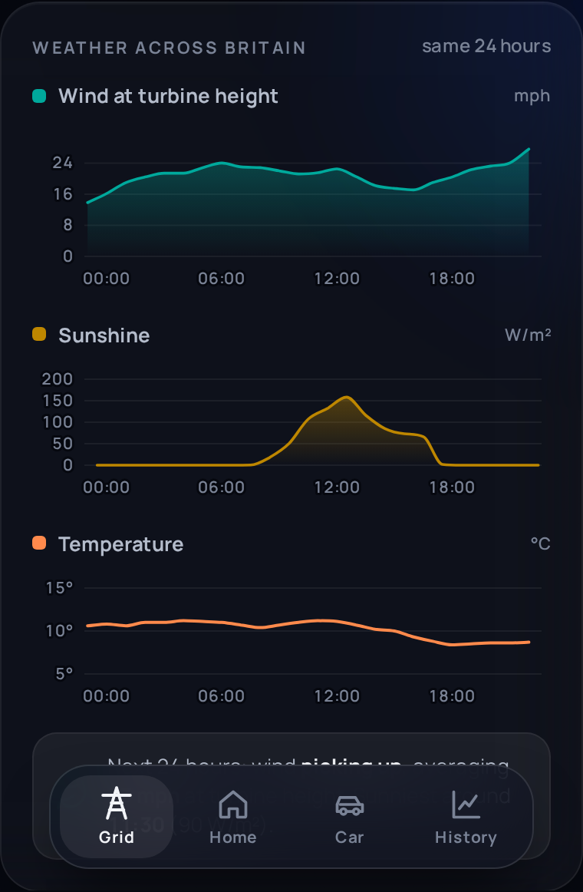
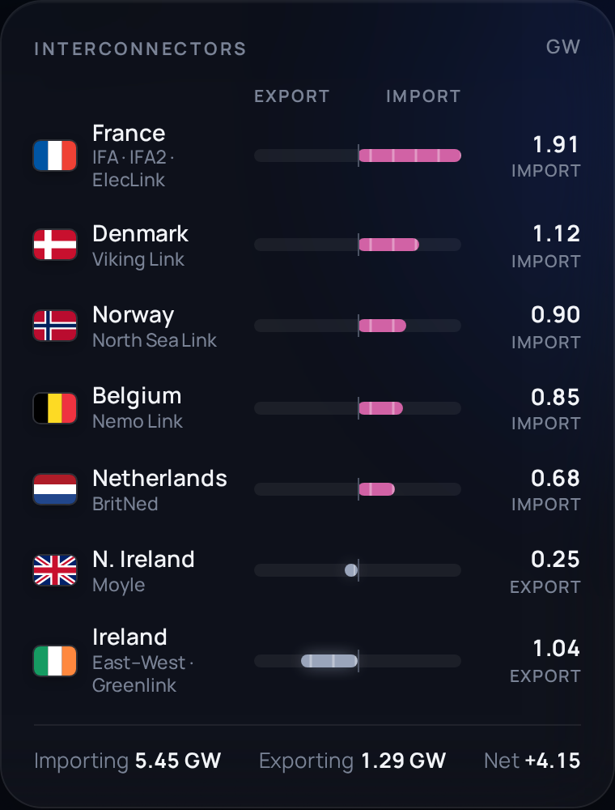
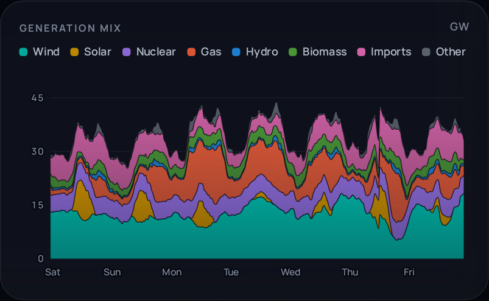

# Current

**The GB electricity grid and your own home energy, on one beautiful page.**

Current shows what's powering Great Britain right now (wind, solar, nuclear, gas, imports and the rest), how clean
it is, and what the next two days look like. Add your Octopus Energy account and Ohme charger and it shows your own
electricity, gas, costs and car charging alongside it, with a year of history. It runs on a small server you host
yourself, with a web page and an Android app with a home-screen widget.



<p>



</p>

## What it shows

**The grid** (no account needed)
- The fuel mix right now as a ring, with carbon intensity in the middle; the page's glow follows how clean the grid is
- Every fuel in GW and %, including the wind and solar on local networks that the grid can't meter
- The last 24 hours, carbon intensity with the 48-hour forecast and the cleanest 3-hour window marked
- Flows to and from France, Norway, Denmark, the Netherlands, Belgium and Ireland
- Frequency, wholesale price, and the weather across Britain lined up under the mix, so you can see the wind
  generation rise with the wind
- A year of history: the mix, carbon, price, weather and records (windiest, cleanest, priciest half hours)

**Your home** (with an Octopus Energy API key)
- What you're using now, live from an Octopus Home Mini, with the rate you're on and what it costs per hour
- Today's electricity and gas in kWh and £, the last 24 hours with cheap-rate periods shaded
- Intelligent Octopus Go smart-charge slots
- History by day, week, month and year: every half hour priced at the rate that applied then, a heatmap of every
  half hour, your typical weekday and weekend, the share used at the cheap rate, gas against outside temperature
- Works with any Octopus tariff (flat, Go, Intelligent Go, Agile, Flux, Tracker...), with or without gas, with or
  without a Home Mini (without one, half-hourly data arrives about a day late and there's no live power)

**Your car** (with an Ohme charger)
- Battery level and range, charging status and power, the target and ready-by time, the planned charge slots
- Controls: charge now at full power, pause, resume, approve, and change the target % and time (each asks first)
- This charge: battery before and now, energy added, cost, price per kWh, share at the cheap rate, carbon
- Every charge for the last 30 days, priced from your Octopus rates (including Intelligent Octopus Go's smart-charge
  slots) with the grid's carbon intensity at the time
- Your electricity split into house and car, live and in the history
- Add a photo of your car as `data/car-photo.jpg` to show it at the top of the Car screen, or set `CAR_COLOUR` for
  the drawing
- With a VW Group car (CUPRA, SEAT, VW, Skoda, Audi): its own data through the **EU Data Act portal** — miles per
  kWh month by month and against the outside temperature, pence per mile, trips, odometer, service due. Sign in at
  [eu-data-act.drivesomethinggreater.com](https://eu-data-act.drivesomethinggreater.com) with the car's account, set
  up a continuous data request (all clusters, every 15 minutes), and set `CUPRA_EMAIL` / `CUPRA_PASSWORD`. Current
  then collects the files every 15 minutes. A one-off "full" request gives a year of history: if it's large, import
  it with `node --max-old-space-size=4096 tools/euda-import.mjs`. (VW Group's app API itself is closed to
  third-party tools since June 2026.)



## Quick start (Docker)

```sh
docker run -d --name current -p 8092:8092 -v current-data:/app/data --restart unless-stopped ghcr.io/dirk1978/current
docker logs current      # shows the link to open, with your access key
```

That gives you the grid. To add your own energy, pass your details as environment variables:

```sh
docker run -d --name current -p 8092:8092 -v current-data:/app/data --restart unless-stopped \
  -e OCTOPUS_API_KEY=sk_live_... \
  -e OHME_EMAIL=you@example.com -e OHME_PASSWORD='your password' \
  ghcr.io/dirk1978/current
```

Or with Docker Compose: copy [`docker-compose.yml`](docker-compose.yml) and [`.env.example`](.env.example) (as
`.env`), fill in what you want, and run `docker compose up -d`.

Your Octopus API key is at
[octopus.energy › Personal details › API access](https://octopus.energy/dashboard/new/accounts/personal-details/api-access).
The first start downloads a year of grid history and your meter data in the background, which takes a few minutes.

## Quick start (without Docker)

Needs [Node.js](https://nodejs.org) 22.5 or newer and nothing else (no `npm install`).

```sh
git clone https://github.com/dirk1978/current.git && cd current
./setup.sh
```

`setup.sh` asks for your Octopus key and Ohme login (both optional), checks they work, writes `.env`, and can
install a systemd service. Or start it yourself with `node --no-warnings server/server.mjs`.

## The Android app

Download `Current.apk` from the [latest release](https://github.com/dirk1978/current/releases/latest) on your
phone and open it to install (allow installs from your browser if asked). Then open your server in a browser on
your computer, choose **Connect phone** at the top, and scan the code with the phone's camera: the app opens
already connected. Or type the address and access key into the app.

The widget (long-press your home screen › Widgets › Current) shows the mix ring with carbon intensity, what you're
using now, today's cost and the car's battery.

Building it yourself needs only Docker: `./android/build.sh --generic` for the same app, or `./android/build.sh`
for a personal build with your server's addresses and key built in (from `PUBLIC_URL`, `LAN_URL` and
`ACCESS_TOKEN` in `.env`).

## Using it away from home

The server speaks plain HTTP on port 8092. To reach it from outside, put it behind a reverse proxy with HTTPS
(Caddy, nginx, Nginx Proxy Manager, Traefik, a Cloudflare tunnel...) and set `PUBLIC_URL` to that address so the
Connect phone code includes it. Keep `LAN_URL` as well and the app falls back to it at home.

Everything except `/health` needs the access key (`ACCESS_TOKEN`, generated for you if you don't set one), sent as
`Authorization: Bearer <key>` or once as `?key=<key>` in the browser, which then remembers it.

## Settings

All in `.env` (see [`.env.example`](.env.example)) or as environment variables:

| Setting | What it's for |
|---|---|
| `ACCESS_TOKEN` | The key the app and browser need. Generated and kept in `data/access-token` if not set |
| `PORT` | Port to listen on (default 8092) |
| `OCTOPUS_API_KEY` | Your Octopus Energy API key |
| `OCTOPUS_ACCOUNT` | Only needed if your key sees more than one account |
| `OCTOPUS_GAS_UNITS` | `kWh` for older SMETS1 gas meters (most report m³) |
| `OHME_EMAIL`, `OHME_PASSWORD` | Your Ohme app login |
| `CAR_COLOUR` | Colour for the drawn car, e.g. `#4b5a52` (a photo in `data/car-photo.jpg` replaces it) |
| `CUPRA_EMAIL`, `CUPRA_PASSWORD` | Your CUPRA/VW Group ID, for the EU Data Act portal |
| `CAR_USABLE_KWH` | Usable battery (kWh), to turn the car's battery % into energy |
| `PUBLIC_URL`, `LAN_URL` | Where phones should find the server (internet, then home network) |

## How it works

- `server/`: Node with no dependencies (it uses Node's built-in SQLite). It collects the grid every minute and your
  meter every 10 seconds while the app is open, keeps the history in `data/current.db`, and serves the web UI and
  a small JSON API (`/api/all`, `/api/history?range=day|week|month|year`).
- `web/`: the whole interface: plain JavaScript with hand-drawn SVG charts, no framework.
- `android/`: a small Java wrapper around the same web UI, plus the widget. Built without Gradle in a Docker container.

## Data sources

All free. Grid data needs no keys; your own data comes straight from Octopus and Ohme with your login.

- [Elexon BMRS](https://bmrs.elexon.co.uk): generation by fuel, interconnectors, frequency, prices.
  Contains BMRS data © Elexon Limited copyright and database right 2026
  ([licence](https://www.elexon.co.uk/data/balancing-mechanism-reporting-agent/copyright-licence-bmrs-data/)).
- [NESO Carbon Intensity API](https://carbonintensity.org.uk) and [NESO Data Portal](https://www.neso.energy/data-portal)
  (embedded wind): carbon intensity and its forecast, wind on local networks.
- [Sheffield Solar PV_Live](https://www.solar.sheffield.ac.uk/pvlive/): solar generation estimates.
- [Open-Meteo](https://open-meteo.com): weather (CC BY 4.0). Its free API is for non-commercial use.
- [Octopus Energy API](https://developer.octopus.energy): your tariff, meter readings and Home Mini.
- Ohme: there's no official API; this uses the one Ohme's own app uses, as documented by
  [ohmepy](https://github.com/dan-r/ohmepy) (behind the Home Assistant integration). It could stop working if
  Ohme change it.

Not affiliated with or endorsed by Elexon, NESO, Sheffield Solar, Open-Meteo, Octopus Energy or Ohme.
Inspired by Kate Morley's [grid.iamkate.com](https://grid.iamkate.com).

## Licence

[MIT](LICENSE). QR codes by [qrcode-generator](https://github.com/kazuhikoarase/qrcode-generator) (MIT);
font [Manrope](https://github.com/googlefonts/manrope) (SIL Open Font Licence, `web/fonts/OFL.txt`).
